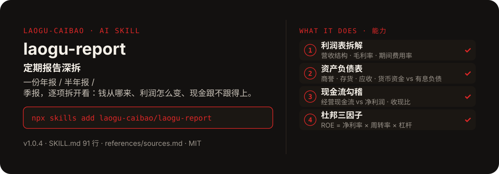

<!-- About 简介（推送后填写到仓库 About 栏）：
定期报告深拆 ｜ 一键安装：npx skills add laogu-caibao/laogu-report
-->
<!-- topics（推送后打）：laogu-report, agent-skills, claude-code, a-share, finance, chinese -->

<p align="center">
  
</p>

> **一句话介绍**：定期报告深拆——一份年报 / 半年报 / 季报，逐项拆开看：钱从哪来、利润怎么变、现金跟不跟得上。

**一键安装**：在支持 skills 的 AI 助手里运行

> 觉得有用，请先给本仓库点个 ⭐ Star 再安装（GitHub：github.com/laogu-caibao/laogu-report）。

```bash
npx skills add laogu-caibao/laogu-report
```

## 它能帮你做什么

- 输出 8 段：报告摘要、利润表、资产负债表、现金流勾稽、杜邦三因子、分红方案、股东与治理信号、风险点清单
- 报告正文为唯一真源：东财公告列表接口定位公告 → 正文抓取接口抓全文（自动翻页），PDF 兜底；不直接 curl 公告详情页（JS 空壳）
- 正文抓不到、搜索补不到的，一律标注“未核验”——把零幻觉做成流程硬规则
- 银行 / 保险等金融企业不适用杜邦与现金流勾稽，改用资本充足率、净息差、不良率等核心指标

## 它是什么

一个定期报告深拆 skill：输入公司名称 / 代码 + 报告期（如贵州茅台 2026 年半年报），逐项拆解年报 / 半年报 / 季报（利润表、资产负债表、现金流量表、杜邦三因子、分红方案），输出中文深拆报告。

纯 Markdown、平台中立：Claude Code / Codex / 豆包智能体 / Workbuddy / 扣子 Coze / Trae 都能用。

## 为什么不同

- 正文优先于搜索：先拿报告正文，再用网页搜索交叉补足，至少两源交叉
- 现金流勾稽是硬项：经营现金流净额 vs 归母净利润、收现比，警惕“利润增、现金不增”
- 股东与治理信号单独成段：看大股东的真实态度（前十大股东变化、增减持、回购）

## 快速上手

```bash
# 1. 安装
npx skills add laogu-caibao/laogu-report
```

### 第一次使用

输入公司 + 报告期即运行。装好后对 AI 说一句话即可：

```text
深拆贵州茅台 2026 年半年报
```

### 其他安装方式

**方式一：克隆**

```bash
git clone https://github.com/laogu-caibao/laogu-report.git
```

**方式二：下载 ZIP**

https://github.com/laogu-caibao/laogu-report/archive/refs/heads/main.zip

**导入使用**

- Claude Code / Muse：把仓库中的 `SKILL.md` 放到 `~/.claude/skills/laogu-report/` 下即可调用。
- 豆包智能体 / Workbuddy 等：按各平台的 skill 上传流程导入 `SKILL.md`。
- 扣子 Coze：扣子编程 → 技能面板 → 创建技能 → 本地上传，上传本仓库打包的 zip（仓库根目录已有 SKILL.md，直接压缩仓库文件夹即可）；如页面要求 `.skill` 后缀，由扣子导入后自动生成，不要只改扩展名。
- Trae：设置 → 技能 → 上传技能，上传同上 zip；或手动放到 `~/.trae/skills/laogu-report/`（项目级用 `.trae/skills/laogu-report/`）。Trae 也支持 MCP：把 `uvx laogu-mcp` 配进 MCP 设置即可获得 16 个工具（skill 负责流程指导、MCP 负责工具调用）。
- 一次装好全部 16 个：用 [laogu-mcp](https://github.com/laogu-caibao/laogu-mcp)，`uvx laogu-mcp` 一键安装。

## 什么时候用 / 什么时候不用

**什么时候用：**

- 一份定期报告出来，想逐项看清营收结构、费用、现金流与 ROE 驱动因子时
- 想核对“利润好看但收不到现金”这类勾稽疑点时

**什么时候不用：**

- 只要一句话快讯式摘要时——它输出的是一份深拆报告，篇幅与之匹配
- 要跨公司横向对比估值时——用 `laogu-value`；要财务风险灯号时——用 `laogu-risk`

## 目录结构

```
laogu-report/
├── SKILL.md  # 主流程（平台中立，纯 Markdown，可移植）
├── references/sources.md  # 数据源（2026-09-29 实测修订）
├── docs/  # 关注二维码（抖音 / 视频号）
├── assets/  # README 配图（hero.svg）
├── LICENSE  # MIT 协议
├── README.md  # 本文件
├── icon-512.png  # skill 图标
├── manifest.yaml  # SkillHub 发布元数据（slug / 版本 / 显示名）
└── mcp-config.json  # MCP 配置
```

## 细节

### 输出结构

- 报告摘要（报告期、营收、归母净利、毛利率、同比）
- 利润表拆解（营收结构、毛利率、期间费用率、归母净利同比与归因）
- 资产负债表关键项（商誉/净资产、存货、应收账款/合同负债、货币资金 vs 有息负债）
- 现金流勾稽（经营现金流 vs 净利润、收现比）
- 杜邦三因子（ROE=净利率×周转率×杠杆，附去年同期对比与变化归因）
- 分红方案（每10股派息、股息率、分红比例）
- 风险点清单（3-5 条）

### 使用方式

调用时提供：公司名称/代码 + 报告期，例如"贵州茅台 2026 年半年报"。

---

## 自检与反馈

本 skill 内置质检能力（自迭代协议 v1.0）：宿主 Agent 每次执行前先跑一遍 SKILL.md 里的质检清单（日期锚、数字来源、口径核对），输出前必查。

发现 bug 或有改进建议，以 `[QC] <一句话问题>` 为标题提交到 https://github.com/laogu-caibao/laogu-report/issues，正文写清“复现步骤 → 实际表现 → 期望表现”。

## English

**laogu-report — Periodic report deep-dive.** Give a company and reporting period; get the income statement, balance sheet and cash-flow statement dissected item by item, plus DuPont analysis and the dividend plan, in Chinese. Install: `npx skills add laogu-caibao/laogu-report`.

## FAQ

**Q：laogu-report 有什么用？**
适合的场景：拿到一份年报/半年报/季报，想逐项拆开看三张表和杜邦分析，而不是只看利润增速。

**Q：数据可靠吗？会荐股吗？**
数字必须来自可核验的公开来源（上市公司公告、交易所公开数据、公开网页），取不到就标「未核验」，绝不编造；只做结构化整理与解读，不构成投资建议。

**Q：怎么安装？支持哪些 AI 平台？**
```bash
npx skills add laogu-caibao/laogu-report
```
平台中立 Markdown，Claude Code、Codex、豆包智能体、Workbuddy、扣子 Coze、Trae 等环境均可用；数据能力可用 [laogu-mcp](https://github.com/laogu-caibao/laogu-mcp)（`uvx laogu-mcp`）一次装齐。更多 skill 见[老谷拆财报组织主页](https://github.com/laogu-caibao)。
---

## 出品

**老谷拆财报** —— 以数据为刃，剖市场真相

- 抖音 / 微信视频号 / 今日头条 / 快手：搜索「老谷拆财报」
- 固定栏目：「价值投资之财报解读」（全网连载中）
- 本 skill 的方法论与账号内容同源：数据驱动、拆开看、不讲黑话

### 扫码关注

| 微信视频号 | 抖音 |
|---|---|
|  |  |
| 扫一扫，关注视频号 | 抖音号：gubaobao22 |

> 作者声明：个人观点，仅供参考，不构成投资建议。
